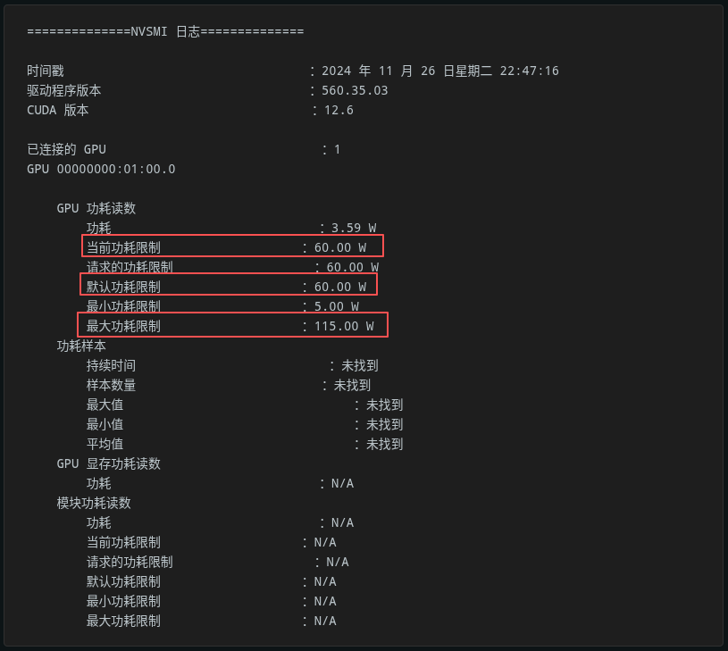
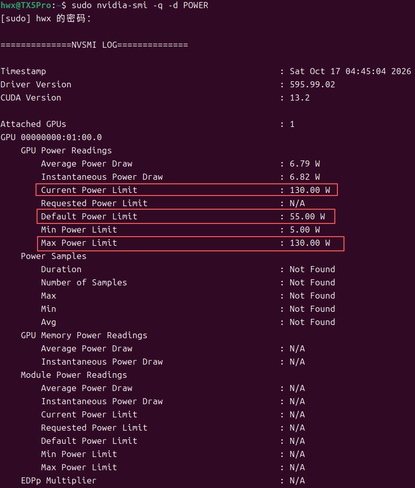

# NVIDIA显卡在Linux系统某些驱动下概率锁功率的解决办法

### 1、首先打开性能模式，Terminal运行 `sudo nvidia-smi -q -d POWER` 查看当前功率限制和最大功率限制
如下图，功率限制一般表现为当前功率限制为最大功率限制的一半。



**罪魁祸首**：`nvidia-powerd.service`没有自动复制到`systemctl`服务路径，导致nvidia显卡的功率控制服务无法被系统调用。

### 2、要修复这个问题，从`/usr/share/doc/nvidia-kernel-common-[version]`复制`nvidia-powerd.service`到`/lib/systemd/system`并重新启用`systemctl enable nvidia-powerd.service`服务。
```bash
# 1、搬运`nvidia-powerd.service`到`lib`
sudo cp /usr/share/doc/nvidia-kernel-common-[version]/nvidia-powerd.service /lib/systemd/system
# 2、重启`systemctl enable nvidia-powerd.service`服务
sudo systemctl enable nvidia-powerd.service
# 3、重启电脑
reboot
```
### 3、验证：打开性能模式，Terminal再次运行 `sudo nvidia-smi -q -d POWER` 
如下图，当前功率限制已达到最大功率限制，但某些机型在混合模式下（即非独显直连）当前最大功率会与最大功率限制有些许出入，为正常现象。


### 参考文献
**[NVIDIA显卡在Ubuntu系统下功率限制解决方案](https://www.reddit.com/r/linux_gaming/comments/1h0nz4a/rtx_4060_tdp_limited_only_on_ubuntu/?tl=zh-hans)**